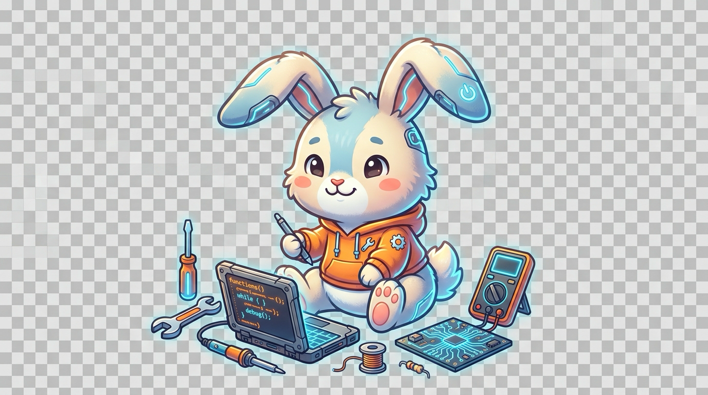

<div align="center">

  <!-- 1. HEADER BANNER & ARTWORK -->
  

  <br/>

  <!-- TYPING SVG SUBHEADER -->
  <a href="https://github.com/sukrut07">
    
  </a>

  <br/><br/>

  <!-- SOCIAL BADGES ROW -->
  <a href="https://www.linkedin.com/in/sukrut-dusane-b44813386/" target="_blank">
    
  </a>
  <a href="https://portfoliosukrut.vercel.app/" target="_blank">
    
  </a>
  <a href="https://github.com/sukrut07" target="_blank">
    
  </a>
  <a href="https://leetcode.com/u/sukrut_07/" target="_blank">
    
  </a>
  <a href="https://www.codechef.com/users/sukrut_07" target="_blank">
    
  </a>
  <a href="https://www.instagram.com/sukrut.xo/" target="_blank">
    
  </a>

  <br/><br/>

  <!-- PROFILE VIEWS COUNTER -->
  

</div>

<br/>
<hr/>
<br/>

<!-- 2. ABOUT ME -->
## 🚀 About Me

```bash
$ cat about.json
```

```json
{
  "name": "Sukrut Dusane",
  "username": "sukrut07",
  "education": "Undergraduate Student in Data Science and AI-ML",
  "focus": [
    "Full-Stack Web Platforms",
    "Computer Vision & Edge AI",
    "Scalable Cloud Systems"
  ],
  "currently_learning": [
    "Federated Learning & Decentralized AI",
    "Advanced Algorithmic Problem Solving (DSA)",
    "State-of-the-Art Neural Vision Architectures"
  ],
  "interests": [
    "Interactive Web Platforms & Modern UI/UX",
    "Real-time Computer Vision & Anomaly Detection",
    "IoT & Smart Sensor Agricultural Telemetry",
    "Open Source & Competitive Programming"
  ],
  "competitive_programming": {
    "leetcode": "sukrut_07",
    "codechef": "sukrut_07"
  },
  "status": "Always building, always learning 🚀"
}
```

### 💡 At a Glance

- 🎓 **Academic Journey**: Undergraduate student specializing in **Data Science and Artificial Intelligence & Machine Learning (AI-ML)**, bridging algorithmic theory with production software engineering.
- 🎯 **Current Focus**: Designing responsive, high-performance web applications and computer vision pipelines for real-world automation.
- 🌱 **Currently Exploring**: Edge AI deployments, federated learning paradigms, and distributed data systems.
- 🛠️ **What I Love Building**: Full-stack platforms, smart IoT sensor networks for precision agriculture, and financial anomaly detection tools.
- 🧩 **Algorithmic Problem Solving**: Actively tackling challenges on [LeetCode](https://leetcode.com/u/sukrut_07/) and [CodeChef](https://www.codechef.com/users/sukrut_07).
- 📫 **Let's Connect**: Reach out on [LinkedIn](https://www.linkedin.com/in/sukrut-dusane-b44813386/), check out my [Portfolio](https://portfoliosukrut.vercel.app/), or say hi on [Instagram](https://www.instagram.com/sukrut.xo/).

<br/>
<hr/>
<br/>

<!-- 3. STARRY NIGHT ASCII ART -->
## 🌌 Inspiration: The Starry Night

<details open>
<summary><b>🎨 Click to toggle Vincent van Gogh — "The Starry Night" (Monospace ASCII Edition)</b></summary>

```text
 *      . : * .         . : .              . : * .          ( ( (   ) ) )
  . : * .    . *      : .     . :        : .     . :        ( (  (   ) ) )
      .  _ . - - - . _     . * .           _ . - - - . _     (  ( C )  ) )
  /\    /   . --- .   \     .    .        /   . --- .   \     ( (  (   ) ) )
 /  \  |  /  . - . \  |    . : .         |  /  . - . \  |      ( ( (   ) ) )
/ /\ \ | |  /     \ | |                  | |  /     \ | |  *         '   '
|/  \| | | |   *  | | |    *       *     | | |   *  | | |    .   :   *  . 
| /\ | | |  \     / | |                   | |  \     / | | .       .    : 
|/  \|  \ \  '-.-' / /      . : * : .      \ \  '-.-' / /   .   :   .     
| /\ |   \ ' - - -' /     . : * . . * : .   \ ' - - -' /  *       *     * 
|/  \|    '-. _ . -'     : .           . :   '-. _ . -'      .     :   .  
| /\ |          .       *                 *        .      .   :    *    . 
|/  \|      . :   : .    . : * . . * : .    . :   : .               .     
| () |     : *     * :  : .           . :  : *     * :      *          *  
|    |      . :   : .    *             *    . :   : .      .   :   .   :  
| () |   /\     .         . : * . . * : .       .         _ . - - - . _   
|    |  /  \           . : .           . : .        _ . -~             ~- 
| () | / /\ \  _ . - ~ ~                     ~ ~ - . _     _ . - - - . _  
|    |/ /  \ \|-~   _ . - - - . _         _ . - - - . _~- .~             ~
| () | | /\ | |  .-~             ~- . _ .-~            ~- . ~- . _        
|    | |/  \| |_.-~                     ~                    ~- . _ ~- . _
| () | / /\ \ |     _/\_                 _|^|_               _  ~- . _    
|    |/ /  \ \|    /    \      /\       |  +  |    _/\_     / \       ~-  
| () | | () | |   /  /\  \    /  \      | === |   /    \   /   \     _/\_ 
|    | |    | |  /  /  \  \  / /\ \     |  |  |  /  /\  \ /  /\ \   /    
| () | | () | | /__/_[]_\__\/ /  \ \    | [ ] | /  /  \  \  /  \ \ /  /\  
|    | |    | || [] |  [ ] | /____\_\___|_____|_/__/_[]_\__\/____\_/__/_/_
| () | | () | || [] |  [ ] | | [] |   | [ ] |  | [ ] |    | [ ] |  | [] | 
==========================================================================
```

<p align="center">
  <i>"I know nothing with any certainty, but the sight of the stars makes me dream." — Vincent van Gogh</i>
</p>

</details>

<br/>
<hr/>
<br/>

<!-- 4. TECH STACK -->
## 🛠️ Tech Stack & Tooling

<div align="center">

  <!-- Interactive Skillicons Icon Strip (Centered & Responsive) -->
  <a href="https://skillicons.dev">
    
  </a>

</div>

<br/>

| Category | Technologies & Tools |
|:---|:---|
| **Languages** |           |
| **Frontend** |       |
| **Backend & Frameworks** |       |
| **AI/ML & Computer Vision** |       |
| **Game Dev & Graphics** |    |
| **Databases** |      |
| **Cloud & DevOps** |          |
| **IoT & Hardware** |    |
| **Tools & Software** |       |

<br/>
<hr/>
<br/>

<!-- 5. CERTIFICATIONS AND BADGES (CREDLY) -->
## 🏅 Certifications & Badges

<p align="center">
  <a href="https://www.credly.com/users/sukrut-dusane" target="_blank">
    
  </a>
</p>

<!-- ========================================================================================================= -->
<!-- HOW TO ADD A NEW CREDLY BADGE:                                                                            -->
<!-- 1. Copy your verified badge URL from https://www.credly.com/users/sukrut-dusane                           -->
<!-- 2. Copy the badge image address (e.g. https://images.credly.com/images/<UUID>/image.png)                  -->
<!-- 3. Add or replace a <td>...</td> block inside the table below:                                           -->
<!--    <td align="center" width="25%">                                                                        -->
<!--      <a href="BADGE_PAGE_URL" target="_blank">                                                           -->
<!--        <br/><b>BADGE_NAME</b>                    -->
<!--      </a>                                                                                                 -->
<!--    </td>                                                                                                  -->
<!-- ========================================================================================================= -->

<div align="center">
<table border="0">
  <tr>
    <td align="center" width="33%">
      <a href="https://www.credly.com/org/amazon-web-services/badge/aws-certified-cloud-practitioner" target="_blank">
        
        <br/><b>AWS Certified<br/>Cloud Practitioner</b>
      </a>
    </td>
    <td align="center" width="33%">
      <a href="https://www.credly.com/org/amazon-web-services/badge/aws-certified-solutions-architect-associate" target="_blank">
        
        <br/><b>AWS Solutions Architect<br/>Associate</b>
      </a>
    </td>
    <td align="center" width="33%">
      <a href="https://www.credly.com/org/amazon-web-services/badge/aws-certified-developer-associate" target="_blank">
        
        <br/><b>AWS Certified Developer<br/>Associate</b>
      </a>
    </td>
  </tr>
</table>
</div>

<br/>
<hr/>
<br/>

<!-- 6. FEATURED PROJECTS -->
## 📌 Featured Projects

<div align="center">
<table border="0">
  <tr>
    <td width="50%" align="center">
      <a href="https://github.com/sukrut07/federated-learning-system" target="_blank">
        
      </a>
      <p align="left">
        🧠 <b>Federated Learning & Edge AI</b><br/>
        <i>Privacy-preserving decentralized machine learning platform for distributed edge inference and client-side model aggregation.</i>
      </p>
    </td>
    <td width="50%" align="center">
      <a href="https://github.com/sukrut07/fraud-anomaly-detector" target="_blank">
        
      </a>
      <p align="left">
        🛡️ <b>Fraud & Anomaly Detection</b><br/>
        <i>Real-time financial transaction anomaly detection engine utilizing unsupervised graph learning and streaming telemetry.</i>
      </p>
    </td>
  </tr>
  <tr>
    <td width="50%" align="center">
      <a href="https://github.com/sukrut07/agrin-regenerative-agricultural-intelligence1" target="_blank">
        
      </a>
      <p align="left">
        🌱 <b>IoT Soil Sensing for Farmers (Agrin)</b><br/>
        <i>Precision agricultural telemetry aggregating multi-sensor soil data, moisture forecasting, and regenerative crop guidance.</i>
      </p>
    </td>
    <td width="50%" align="center">
      <a href="https://github.com/sukrut07/ai-financial-journey" target="_blank">
        
      </a>
      <p align="left">
        📈 <b>AI Financial Journeys</b><br/>
        <i>Intelligent personal wealth navigation platform with goal forecasting, automated expense categorization, and smart advisory.</i>
      </p>
    </td>
  </tr>
</table>
</div>

<p align="center">
  <a href="https://github.com/sukrut07?tab=repositories" target="_blank">
    
  </a>
</p>

<br/>
<hr/>
<br/>

<!-- 7. GITHUB STATS & METRICS -->
## 📊 GitHub & Problem Solving Metrics

<div align="center">

  <!-- OVERALL STATS & TOP LANGUAGES -->
  <p align="center">
    
    
  </p>

  <!-- STREAK STATS (DENVERCODER1 RECOMMENDED ENDPOINT) -->
  <p align="center">
    
  </p>

  <!-- ACTIVITY GRAPH -->
  <p align="center">
    
  </p>

  <!-- GITHUB TROPHIES -->
  <p align="center">
    
  </p>

  <!-- LEETCODE STATS CARD -->
  <p align="center">
    <a href="https://leetcode.com/u/sukrut_07/" target="_blank">
      
    </a>
  </p>

</div>

<br/>
<hr/>
<br/>

<!-- 8. PAC-MAN CONTRIBUTION GAME -->
## 🕹️ Contribution Arcade: Pac-Man

<div align="center">

  <!-- Responsive Theme-Adaptive Picture: Prefers Dark / Light SVGs from output branch -->
  <picture>
    <source media="(prefers-color-scheme: dark)" srcset="https://raw.githubusercontent.com/sukrut07/sukrut07/output/pacman-contribution-graph-dark.svg">
    <source media="(prefers-color-scheme: light)" srcset="https://raw.githubusercontent.com/sukrut07/sukrut07/output/pacman-contribution-graph.svg">
    
  </picture>

  <p>
    <i>🎮 Pac-Man eating through my contribution grid! Automatically generated and rendered every 12 hours via GitHub Actions.</i>
  </p>

</div>

<br/>
<hr/>
<br/>

<!-- 9. SUPPORT ME -->
## ☕ Support My Work

<div align="center">

  <p>If you find my projects, open-source work, or tools helpful, consider supporting my journey!</p>

  <a href="https://www.buymeacoffee.com/sukrut07" target="_blank">
    
  </a>

</div>

<br/>
<hr/>
<br/>

<!-- 10. FOOTER -->
<div align="center">

  <h3>📫 Let's Connect</h3>

  <a href="https://www.linkedin.com/in/sukrut-dusane-b44813386/" target="_blank">
    
  </a>
  <a href="https://github.com/sukrut07" target="_blank">
    
  </a>
  <a href="https://portfoliosukrut.vercel.app/" target="_blank">
    
  </a>
  <a href="https://leetcode.com/u/sukrut_07/" target="_blank">
    
  </a>
  <a href="https://www.codechef.com/users/sukrut_07" target="_blank">
    
  </a>
  <a href="https://www.instagram.com/sukrut.xo/" target="_blank">
    
  </a>

  <br/><br/>

  <p>
    <i>⭐️ Crafted with passion by <a href="https://github.com/sukrut07"><b>Sukrut Dusane</b></a> — Always Building, Always Learning 🚀</i>
  </p>

  <br/>

  <!-- TRANSPARENT FOOTER IMAGE (NO WAVING CAPSULE BACKGROUND) -->
  

</div>
