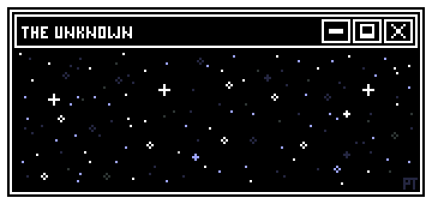
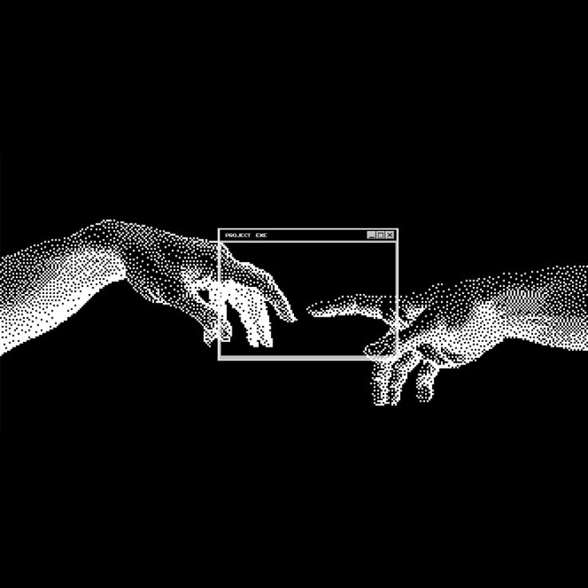
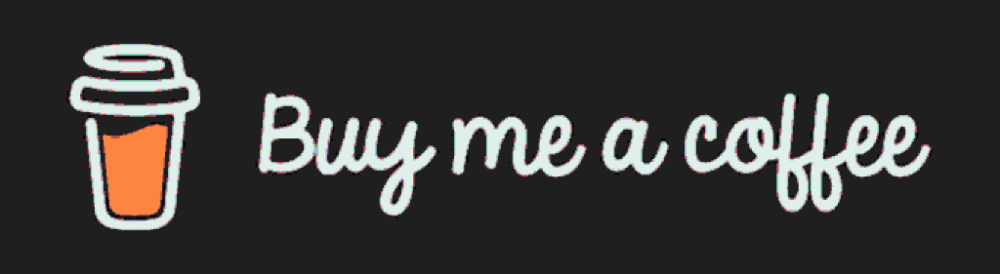

<div align="center">

  <!-- 1. HEADER MEDIA (Starry Night / The Unknown Pixel Art Animation) -->
  

  <!-- Alternative <video> format: drag & drop .mp4 into the GitHub README web editor, paste generated link below: -->
  <!-- <video src="https://github.com/user-attachments/assets/PLACEHOLDER_HEADER_VIDEO" autoplay loop muted playsinline width="100%" style="max-width: 720px; border-radius: 8px;"></video> -->

  <br/>

  <!-- HEADER GREETING -->
  <a href="https://github.com/sukrut07">
    
  </a>

  <!-- TYPING SVG SUBHEADER -->
  <a href="https://github.com/sukrut07">
    
  </a>

  <br/><br/>

  <!-- SOCIAL & RESUME BADGES ROW -->
  <a href="https://drive.google.com/drive/folders/1GobtmQMxCGyy8o4h7qBIju1gagS9U7XU?usp=drive_link" target="_blank">
    
  </a>
  <a href="https://www.linkedin.com/in/sukrut-dusane-b44813386/" target="_blank">
    
  </a>
  <a href="https://portfoliosukrut.vercel.app/" target="_blank">
    
  </a>
  <a href="https://github.com/sukrut07" target="_blank">
    
  </a>
  <a href="https://leetcode.com/u/sukrut_07/" target="_blank">
    
  </a>
  <a href="https://www.codechef.com/users/sukrut_07" target="_blank">
    
  </a>
  <a href="https://www.instagram.com/sukrut.xo/" target="_blank">
    
  </a>

  <br/><br/>

  <!-- PROFILE VIEWS COUNTER (Starting baseline at 700) -->
  

</div>

<br/>
<hr/>
<br/>

<!-- 2. ABOUT ME -->
## 🚀 About Me

```bash
$ cat about.json
```

```json
{
  "name": "Sukrut Dusane",
  "username": "sukrut07",
  "role": "CS Sophomore (AI & Machine Learning) @ MITAOE",
  "experience": [
    "Founding Engineer Intern @ OBLIQ-in (CA Audit Workflows & Open-Source)",
    "AI/ML Intern @ Vicharanshala Labs, IIT Ropar",
    "Junior Animator & Club Coordinator @ Vertex GDNA"
  ],
  "focus": [
    "Applied AI & Machine Learning",
    "Computer Vision & Document Intelligence (OCR)",
    "Full-Stack Web Engineering (FastAPI, Next.js, PostgreSQL)"
  ],
  "competitive_programming": {
    "leetcode": "sukrut_07",
    "codechef": "sukrut_07"
  },
  "status": "Always building, always learning 🚀"
}
```

### 💡 At a Glance

- 🎓 **Education**: B.Tech in CSE (AI & Machine Learning), **MIT Academy of Engineering (MITAOE), Pune**.
- 💼 **Experience**: Founding Engineer Intern at **OBLIQ-in** (automating resources for CA audit firms) | Former AI/ML Intern at **Vicharanshala Labs, IIT Ropar**.
- 🎯 **Technical Focus**: Machine learning architectures, computer vision pipelines, document intelligence (OCR), and full-stack systems.
- 🎮 **Club Leadership**: Junior Animator & Club Coordinator at **Vertex GDNA** (organising Manim-to-Godot learning sessions).
- 🏆 **Hackathons & Competitions**:
  - **1st Runner Up**: PVG Ignition Hackverse (automated insurance underwriting & risk assessment).
  - **1st Place**: Fund Arcade (Pune Start-Up Fest '26, COEP Technological University).
  - **Qualifier**: Smart India Hackathon 2026 Internal Round (Team Agastya_01: PS-26102 MPLADS fraud detection & PS-26239 tribal scholarship platform).
- 📄 **Resume**: [Click here to view / download resume](https://drive.google.com/drive/folders/1GobtmQMxCGyy8o4h7qBIju1gagS9U7XU?usp=drive_link).

<br/>
<hr/>
<br/>

<!-- 3. TECH STACK -->
## 🛠️ Tech Stack & Architecture

<div align="center">

  <!-- Interactive Skillicons Icon Strip -->
  <a href="https://skillicons.dev">
    
  </a>

</div>

<br/>

| Domain | Verified Tools & Libraries |
|:---|:---|
| **Languages** |           |
| **Frontend** |     |
| **Backend & APIs** |       |
| **AI/ML & Data Science** |            |
| **Computer Vision & OCR** |      |
| **MLOps & Evaluation** |     |
| **Federated & Edge AI** |    |
| **Databases** |      |
| **Cloud & DevOps** |         |
| **Game Dev & Animation** |      |
| **IoT & Hardware** |    |
| **Developer Tools** |    |

<br/>
<hr/>
<br/>

<!-- 4. FEATURED PROJECTS -->
## 📌 Featured Projects & Hackathon Work

<div align="center">
<table border="0" width="100%">
  <tr>
    <td width="50%" align="center" valign="top">
      <a href="https://github.com/sukrut07/ParadigmHMX" target="_blank">
        
      </a>
      <p align="left">
        🛡️ <b>ParadigmHMX (InsiderTrace): Risk & Financial Crime Platform</b><br/>
        <i>Evidence-first financial crime and insider risk intelligence engine unifying employee operations, transactional networks, and money-flow subgraphs with graph learning.</i><br/>
        
        
        
        
        
      </p>
    </td>
    <td width="50%" align="center" valign="top">
      <a href="https://github.com/sukrut07/deepfake_detection" target="_blank">
        
      </a>
      <p align="left">
        👁️ <b>Deepfake Detection V2: Production & Research CV Platform</b><br/>
        <i>Scientifically defensible, multi-face and video-capable deepfake detection platform leveraging deep CNN architectures (MesoNet, EfficientNet) and OpenCV analysis.</i><br/>
        
        
        
        
        
      </p>
    </td>
  </tr>
  <tr>
    <td width="50%" align="center" valign="top">
      <a href="https://github.com/sukrut07/SML-Code-Optimiser" target="_blank">
        
      </a>
      <p align="left">
        ⚡ <b>Optima AI: Autonomous Code Optimization Platform</b><br/>
        <i>High-throughput code profiling and automated optimization engine featuring multi-language AST parsing, automated algorithmic complexity reduction, and AI refactoring.</i><br/>
        
        
        
        
      </p>
    </td>
    <td width="50%" align="center" valign="top">
      <a href="https://github.com/sukrut07/Tracera" target="_blank">
        
      </a>
      <p align="left">
        📑 <b>TRACERA: Mini Audit Document Review System</b><br/>
        <i>Calm, document-centric audit review platform engineered for Chartered Accountant (CA) firms to collect, inspect, annotate, and approve client financial documents.</i><br/>
        
        
        
        
      </p>
    </td>
  </tr>
</table>
</div>

### 🏆 Hackathons & Leadership

- **1st Runner Up — PVG Ignition Hackverse**: Developed an automated insurance risk assessment and underwriting platform to streamline risk evaluation and support data-driven decisions for insurance underwriters.
- **1st Place — Fund Arcade (Pune Start-Up Fest '26, COEP Technological University)**: Startup financial analysis and investment decision competition.
- **Smart India Hackathon 2026 Internal Round Qualifier (Team Agastya_01)**:
  - **PS-26102**: AI fraud and anomaly detection for MPLADS Scheme ([ParadigmHMX / Sanchay](https://github.com/sukrut07/ParadigmHMX)).
  - **PS-26239**: AI-Enabled Scholarship and Fellowship Management System for Scheduled Tribes.
- **Vertex GDNA, MITAOE — Junior Animator & Club Coordinator**: Coordinate game development and graphics initiatives, organise Manim-to-Godot learning sessions, and promote collaborative technical learning.

<br/>
<hr/>
<br/>

<!-- 5. CERTIFICATIONS AND BADGES -->
## 🏅 Verified Certifications & Digital Badges

<p align="center">
  <a href="https://www.credly.com/users/sukrut-dusane" target="_blank">
    
  </a>
</p>

<!-- ========================================================================================================= -->
<!-- HOW TO ADD A NEW CREDLY BADGE:                                                                            -->
<!-- 1. Open your badge on https://www.credly.com/users/sukrut-dusane                                          -->
<!-- 2. Copy the badge image URL (e.g. https://images.credly.com/images/<UUID>/image.png)                      -->
<!-- 3. Add a <td> cell inside the corresponding category table below:                                         -->
<!--    <td align="center" width="25%">                                                                        -->
<!--      <a href="BADGE_PAGE_URL" target="_blank">                                                           -->
<!--        <br/><b>BADGE_NAME</b>                    -->
<!--      </a>                                                                                                 -->
<!--    </td>                                                                                                  -->
<!-- ========================================================================================================= -->

### ☁️ Cloud Architecture & Infrastructure
<div align="center">
<table border="0">
  <tr>
    <td align="center" width="33%">
      <a href="https://www.credly.com/org/amazon-web-services/badge/aws-certified-cloud-practitioner" target="_blank">
        
        <br/><b>AWS Certified<br/>Cloud Practitioner</b>
      </a>
    </td>
    <td align="center" width="33%">
      <a href="https://www.credly.com/org/amazon-web-services/badge/aws-certified-solutions-architect-associate" target="_blank">
        
        <br/><b>AWS Solutions Architect<br/>Associate</b>
      </a>
    </td>
    <td align="center" width="33%">
      <a href="https://www.credly.com/org/amazon-web-services/badge/aws-certified-developer-associate" target="_blank">
        
        <br/><b>AWS Certified Developer<br/>Associate</b>
      </a>
    </td>
  </tr>
</table>
</div>

<br/>
<hr/>
<br/>

<!-- 6. GITHUB STATS & DEVELOPER METRICS -->
## 📊 GitHub Analytics & Developer Metrics

<div align="center">

  <!-- OVERALL STATS & TOP LANGUAGES -->
  <p align="center">
    
    
  </p>

  <!-- STREAK STATS (DENVERCODER1 VERIFIED ENDPOINT) -->
  <p align="center">
    
  </p>

  <!-- PROFILE SUMMARY CARDS (DYNAMIC ANIMATED CARDS) -->
  <p align="center">
    
  </p>

  <p align="center">
    
    
  </p>

  <p align="center">
    
  </p>

</div>

<br/>
<hr/>
<br/>

<!-- 7. 3D CONTRIBUTION GRAPH -->
## 🧊 3D Contribution Landscape

<div align="center">

  <!-- 3D Bar Graph SVGs committed to output branch -->
  <picture>
    <source media="(prefers-color-scheme: dark)" srcset="https://raw.githubusercontent.com/sukrut07/sukrut07/output/profile-3d-contrib/profile-night-rainbow.svg">
    <source media="(prefers-color-scheme: light)" srcset="https://raw.githubusercontent.com/sukrut07/sukrut07/output/profile-3d-contrib/profile-green-animate.svg">
    
  </picture>

  <p>
    <i>📊 Isometric 3D visualization of contribution density generated daily via GitHub Actions.</i>
  </p>

</div>

<br/>
<hr/>
<br/>

<!-- 8. GALAGA CONTRIBUTION GAME -->
## 🚀 Contribution Arcade: Galaga

<div align="center">

  <!-- Responsive Theme-Adaptive Picture: Galaga SVGs from output branch -->
  <picture>
    <source media="(prefers-color-scheme: dark)" srcset="https://raw.githubusercontent.com/sukrut07/sukrut07/output/galaga-contribution-graph-dark.svg">
    <source media="(prefers-color-scheme: light)" srcset="https://raw.githubusercontent.com/sukrut07/sukrut07/output/galaga-contribution-graph.svg">
    
  </picture>

  <p>
    <i>👾 Retro Galaga fighter ship shooting lasers to clear contribution blocks! Automatically generated and rendered every 12 hours via GitHub Actions.</i>
  </p>

</div>

<br/>
<hr/>
<br/>

<!-- 9. CONNECT WITH ME (WITH HAND CONNECTION ARTWORK) -->
## 🤝 Connect & Collaborate

<div align="center">
<table border="0" width="100%">
  <tr>
    <!-- Left Column: Textual Info & Social Channels -->
    <td width="55%" valign="middle" align="left">
      <h3>Let's Build Something Meaningful 🚀</h3>
      <p>
        I'm a Computer Science sophomore specializing in <b>AI/ML at MITAOE, Pune</b> with hands-on experience across applied machine learning, computer vision, and scalable full-stack development.
      </p>
      <p>
        Currently working as <b>Founding Engineer Intern at OBLIQ-in</b> building automated audit workflows and open-source tools for CA firms. Previously evaluated and developed ML models as an <b>AI/ML Intern at Vicharanshala Labs, IIT Ropar</b>.
      </p>
      <p>
        <b>Open to collaborate on:</b>
        <br/>• 🧠 Applied AI/ML, Explainable AI (SHAP), and MLOps pipelines
        <br/>• 👁️ Computer Vision, multi-face verification, and OCR document intelligence
        <br/>• 🌐 High-performance Full-Stack applications (FastAPI, Next.js, PostgreSQL)
        <br/>• 🏆 Hackathons, technical competitions, and Open Source (OSCI '26)
      </p>
      <p>
        📫 <b>Direct Contact:</b> <a href="mailto:sukrut.dusane@gmail.com">sukrut.dusane@gmail.com</a> • Pune, Maharashtra
      </p>
      <p>
        <a href="https://drive.google.com/drive/folders/1GobtmQMxCGyy8o4h7qBIju1gagS9U7XU?usp=drive_link" target="_blank">
          
        </a>
        <a href="https://www.linkedin.com/in/sukrut-dusane-b44813386/" target="_blank">
          
        </a>
        <a href="https://portfoliosukrut.vercel.app/" target="_blank">
          
        </a>
        <a href="https://github.com/sukrut07" target="_blank">
          
        </a>
        <a href="https://leetcode.com/u/sukrut_07/" target="_blank">
          
        </a>
        <a href="https://www.codechef.com/users/sukrut_07" target="_blank">
          
        </a>
        <a href="https://www.instagram.com/sukrut.xo/" target="_blank">
          
        </a>
      </p>
    </td>
    <!-- Right Column: Hand Connection Artwork -->
    <td width="45%" valign="middle" align="center">
      
    </td>
  </tr>
</table>
</div>

<br/>
<hr/>
<br/>

<!-- 10. SUPPORT ME & FOOTER -->
## ☕ Support My Work

<div align="center">

  <p>If you find my open-source projects, tools, or research work inspiring, consider buying me a coffee!</p>

  <a href="https://www.buymeacoffee.com/sukrut07" target="_blank">
    
  </a>

  <br/><br/>

  <p>
    <i>⭐️ Engineered with passion by <a href="https://github.com/sukrut07"><b>Sukrut Dusane</b></a> — Always Building, Always Learning 🚀</i>
  </p>

  <br/>

  <!-- JOKER PIXEL-ART FOOTER ANIMATION (NO WAVING CAPSULE BACKGROUND) -->
  

  <!-- Alternative <video> format: drag & drop .mp4 into the GitHub README web editor, paste generated link below: -->
  <!-- <video src="https://github.com/user-attachments/assets/PLACEHOLDER_FOOTER_VIDEO" autoplay loop muted playsinline width="100%" style="max-width: 640px; border-radius: 8px;"></video> -->

</div>
